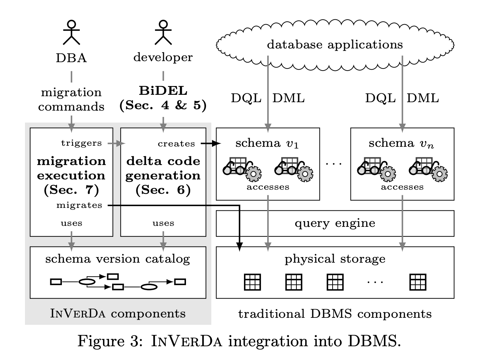

# Paper - Living in Parallel Realities: Co-Existing Schema Versions with a Bidirectional Database Evolution Language (SIGMOD, 2017)

Herrmann, Voigt, Behrend, Rausch, Lehner · [PDF](https://arxiv.org/pdf/1608.05564)

## Section 1 - Introduction
* PRISM only helps old queries **read**. Updates were future work, so an old app that still writes was on its own.
* After a PRISM deploy, only the newest version is real. Older versions are kept alive with views or rewriting, as a compatibility layer on the way out.
* Going back meant keeping a full copy of the old database, or running an inverse script afterwards.
* InVerDa's tries something different: several schema versions live at the same time as equals, every one of them can be read **and written**, and a write in one shows up in all the others.
* BiDEL is the language for describing the change between versions. InVerDa is the system that runs it on top of an ordinary relational database.
* InVerDa generates the "delta code" between versions (views and triggers), so nobody writes it by hand.
* Where the data physically lives can be changed later by the DBA with one command, without the developers changing anything.

> Multiple versions, multiple copies? The paper says no: data is stored once, in whichever version is materialized, and the other versions are computed from it through views, plus auxiliary tables for the bits that don't fit (Sections 3 and 7). But how big do those auxiliary tables get, and do they keep growing as more versions are added? In E3, backfilling one extra column already doubled my table.

> Read and write latency? Reading a version that isn't materialized goes through a view, sometimes a join (E5 lost the index that way, 70 ms vs 0.015 ms). Writing through any version fires triggers that update the real table and the auxiliary tables (E6 was 5× slower than a plain table). With three versions chained together, does one write go through every SMO in between? The evaluation reports averages from a single thread, so there's nothing on tail latency or many writers at once.

## Section 2 - User Perspective
The paper walks through one example from start to finish.

* **Start:** a to-do app, TasKy, with one table: `Task(author, task, prio)`.
* **Two new apps want the same data in a different shape.** Each developer writes a short BiDEL script, and InVerDa generates everything else.
  * **Do!** is a simpler app over the same data. Its `Todo` table only has the priority-1 tasks (`SPLIT`), and drops the `prio` column since it would always be 1. A task added in Do! shows up in TasKy with `prio = 1` (`DEFAULT 1`).
    ```
    CREATE SCHEMA VERSION Do! FROM TasKy WITH
    SPLIT TABLE Task INTO Todo WITH prio=1;
    DROP COLUMN prio FROM Todo DEFAULT 1;
    ```
  * **TasKy2** is a new version of TasKy that keeps authors in their own table (`DECOMPOSE`), and renames `author` to `name`.
    ```
    CREATE SCHEMA VERSION TasKy2 FROM TasKy WITH
    DECOMPOSE TABLE task INTO task(task,prio), author(author) ON FOREIGN KEY author;
    RENAME COLUMN author IN author TO name;
    ```
* **All three run at the same time, on the same data.** A task written through any of them shows up in the other two (made-up rows, to show the shape):

  | TasKy `Task` (author, task, prio) | Do! `Todo` (author, task) | TasKy2 `task` + `author` |
  |---|---|---|
  | Ann, Pay rent, 1 | Ann, Pay rent | Pay rent, 1 · author: Ann |
  | Bob, Buy milk, 3 | *(not shown, prio ≠ 1)* | Buy milk, 3 · author: Bob |

* **Later, the DBA moves the data.** At first the data physically lives in TasKy's table, and the other two versions are computed from it. Once most users are on TasKy2, the DBA runs `MATERIALIZE 'TasKy2';`, and the physical tables now match TasKy2. InVerDa regenerates the views and triggers, and none of the three apps changes.

> Question - Each version "appears to the user like a full-fledged single-schema database", but the paper never says how an app picks its version. A separate schema per version, chosen with `search_path` like pgroll? Then "no app change" is still a connection setting change.

> Question - Keeping versions in the database doesn't remove the deployment, it splits it up. Creating v2 is a database change (new views and triggers on live tables). Pointing each app at v2 is an app rollout, with old and new pods on different versions until it's done. Materializing is another database step, and dropping v1 is only safe once nothing uses it. Who keeps track of which app is still on which version? The paper doesn't say.

## Section 3 - Architecture



Figure 3 splits the system in two: InVerDa's own pieces on the left (grey), and an ordinary database on the right.

* **Right side, the normal database.** Apps send reads (DQL) and writes (DML) to "their" schema version, v1 … vn. Each version is just generated views (for reads) and triggers (for writes), which go through the normal query engine to the physical tables.
* **Left side, what InVerDa adds:**
  * **Delta code generation (Section 6):** the developer writes a BiDEL script, and this turns it into the views and triggers for a new schema version.
  * **Migration execution (Section 7):** the DBA runs a migration command, and this moves the data in physical storage, then asks delta code generation to regenerate the views and triggers to match.
  * **Schema version catalog:** both of them use it. It's the history of all versions, kept as a graph where each node is a version of one table and each edge is the SMO that created it.
* **Auxiliary tables** store whatever one version has that another can't show, so nothing is lost when data goes from one version to another and back.
* By default the data stays in the oldest (source) version, and newer versions are computed from it.
* InVerDa isn't in the path of the app's queries. Once the code is generated, everything runs inside the database as views and triggers.

> Nothing sits between the app and the database at query time, which is nice: if InVerDa itself is down, the versions keep working. But it also means every query on a non-materialized version goes through the planner as a view, which is how E5 lost its index.

> Apps only send DQL and DML in the figure. What about DDL? A later migration, an ORM's schema sync, or a test's `TRUNCATE` (E8) would run against a version made of views. And creating a new version means creating views and triggers on live tables. How long do those locks wait if a long transaction is open (E9)?

> The "migrates" arrow goes straight into physical storage while apps keep reading and writing through their versions. What do they see halfway through: old layout, new layout, or a lock?

> What if someone changes the physical tables directly, with psql or another tool, outside InVerDa? The catalog and the generated code wouldn't know.

## Section 4 - BiDEL: Bidirectional SMOs
* Same idea as PRISM's SMOs: create, drop and rename tables and columns; `ADD COLUMN`, `DROP COLUMN`; `DECOMPOSE` / `JOIN` (split or combine columns); `SPLIT` / `MERGE` (split or combine rows).
* The difference: each SMO comes with mapping rules in both directions, old → new and new → old, written in Datalog.
* `ADD COLUMN a AS f(r1, ..., rn) INTO R` fills a new column with a function of the row, like PRISM.
* `DROP COLUMN ... DEFAULT x` needs a default, used when the older version has to show a row that was written through the newer one.
* "Twins": `SPLIT` can put the same row in two tables. If they're later updated separately they become "separated twins", and the rules treat one side as the master copy.

* To extrapolate into what I am doing. This is my reading of the rules, not something the paper walks through:
  1. Create v2 from v1:
     ```
     CREATE SCHEMA VERSION v2 FROM v1 WITH
     ADD COLUMN status_id AS f(status) INTO orders;
     DROP COLUMN status FROM orders DEFAULT 'pending';
     ```
  2. The data is still physically in v1, as text. v2's `orders` is a view that computes `f(status)` for each row, and keeps the computed values in an auxiliary table. A new-app query like `WHERE status_id = 2` filters on a computed value, so E5's index problem comes back from the other side.
  3. The new app writes through v2, say `status_id = 3`. The trigger has to put something in the physical `status` column, and the drop says `DEFAULT 'pending'`. So the old app on v1 would see `'pending'` for an order that's really shipped.
  4. After `MATERIALIZE 'v2'`, the physical table has `status_id` and v1 becomes the view. v1's `status` comes from the auxiliary table for older rows, and from the default for rows v2 wrote.
  5. Drop v1 once nothing uses it.

> Question - There's no operator for changing a column's type or encoding, only add and drop. BiDEL can't say that `status` and `status_id` are two spellings of the same value. So if steps 3 and 4 are right, the "co-existing versions" disagree for every row the new app writes. The only workaround I can see is keeping both columns in v2, but then the new app has to write `status` as well, which is an app change.

## Summary of claims / benefits
* Old and new schema versions can both be read and written at the same time, and they stay in sync.
* The change is a few lines of BiDEL instead of hundreds of lines of hand-written views and triggers.
* Round trips are proven not to lose data.
* Generated code is about as fast as hand-written code.
* The physical layout can follow the workload, moved by the DBA in one command, with no app changes.

## My 2 cents

InVerDa fixes PRISM's biggest hole: writes. Every version is fully readable and writable, and the proofs say nothing gets lost in between. But the way it does that is views and triggers, which is the exact machinery I built by hand in E3 and then spent E5–E8 watching leak. Generating that code automatically makes it cheaper to write, not cheaper to run.

Some things I keep coming back to:

* **Only one version gets to be a real table.** Everything else is a view, with the view's problems. Wouldn't it be better if every version's queries ran against the real table, just written differently for each version, instead of going through a view?
* **The mapping has to know how to go back.** The model can say "add `status_id` from `status`" and "drop `status`", but not that `status` can be rebuilt from `status_id`. For a value re-encoding, that two-way mapping *is* the whole change. It should be declared once, as one-to-one, and both directions should come from it.
* **Constraints aren't optional.** Primary keys and unique constraints are what upserts stand on. A version layer that leaves them out will break `ON CONFLICT`, and apps use that everywhere.
* **"Available" needs a definition.** The paper moves data with one command and says every version stays available, but doesn't say what live traffic sees while it happens. A migration should be a sequence of known stages, with each step's locks and costs understood, and the app should know which stage it's in.
* **Picking a version is an app change too.** If each app connects to "its" version, that's still configuration, and someone has to coordinate which app runs on which version while they overlap.
* **Moving the data based on the workload is a great idea.** Worth keeping: the physical layout shouldn't be fixed by whoever wrote the first schema.
