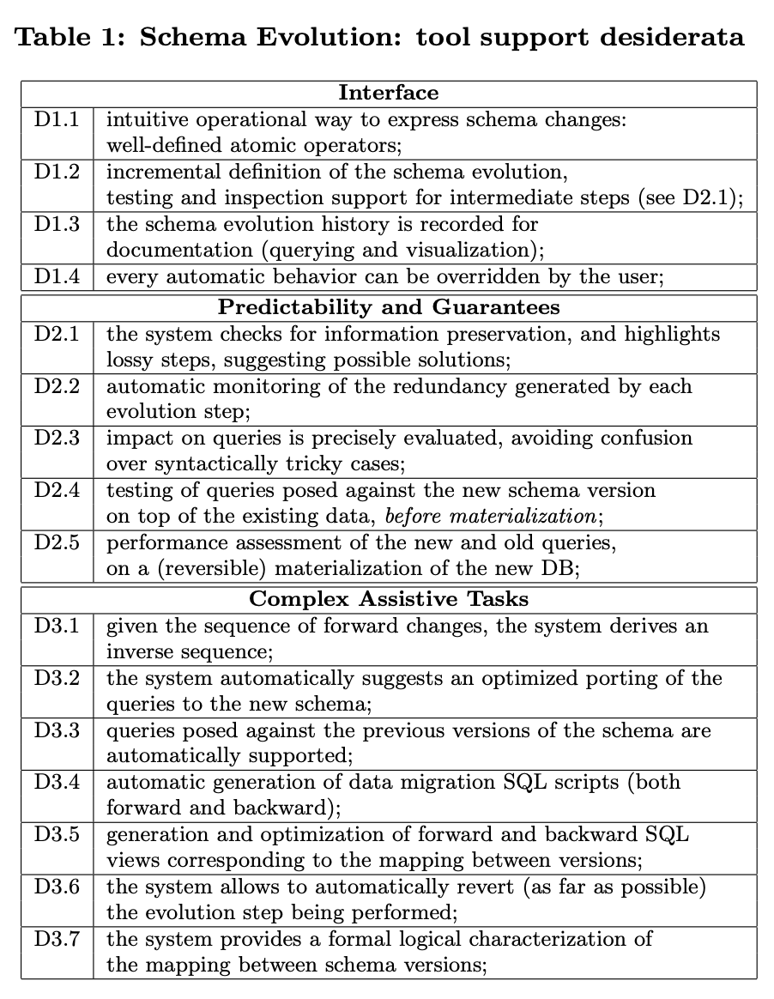

# Paper - Graceful Database Schema Evolution: the PRISM Workbench (VLDB, 2008)

Curino, Moon, Zaniolo · [PDF](https://vldb.org/pvldb/vol1/1453939.pdf)

## Section 1 - Introduction
* Schema changes hit both the data and the queries written against it.
* Today the DBA (database administrator) does both by hand: writes the SQL that moves the data, finds the queries that break, and rewrites them. Nothing checks whether information gets lost along the way.
* PRISM tries to automate three things: rewriting old queries, working out the inverse of a change, and migrating the data.
* Motivated by web information systems like Wikipedia, which change schema often and can't afford much downtime.

## Section 3 - Graceful Schema Evolution
* Wish list is divided in three groups:
  * Interface: express changes step by step, test intermediate steps, keep a history, let the user override.
  * Guarantees: flag lossy steps, watch for redundancy, show which queries are affected, test new queries on existing data.
  * Assistance: derive inverses, suggest how to port queries, support queries on old versions, generate forward and backward SQL and views, revert steps.

* Running example: MediaWiki v41 → v42 touched only 2 of 24 tables, but more than 70% of the query templates.
* Workflow: design the change → generate inverses → validate and check query support → materialize and test performance → deploy.
* Before deploy (step 4, §3.4), the new version is built next to the old one: "the system preserves an untouched copy of DB41 to allow seamless rollback". There's also a script variant that doesn't keep the copy (footnote 13).
  
 > Storage: in E3, just backfilling `status_id` grew the table from 88 MB to 184 MB, and dropping the text column didn't give the space back. Here the old database is kept untouched while the new one is built next to it. Is that a copy of the whole database or only the tables that change ("differentially")? Either way, the changed tables exist twice until deploy, on top of any bloat from filling them. On the plus side, dropping DB41 at deploy should free its space straight away, which a dropped column didn't. What does this cost on a large table, and does the no-copy variant avoid it?

* On deploy (step 5, §3.4), the old DB is dropped and old queries keep working through generated views or "on-line query rewriting".
  
 > In my Phase 1 the view approach kept old queries "working" but leaked: the planner lost the index on a selective read (E5, ~4,700× slower), upserts, TRUNCATE and ALTER failed through the view (E8), and writes got slower (E6). Do PRISM's generated views hit the same limits? And does on-line query rewriting avoid them, since it targets the real tables instead of a view?

* Rolling back after that is a "late rollback": run the inverse script to migrate the data back.

## Section 4 - SMOs and Inverses
* An SMO [(Schema Modification Operator)](https://www.ssp.sh/brain/schema-modification-operators-smos/) is one small, named schema change (add column, rename table…). A migration is a sequence of them, so PRISM knows exactly what each step does.
* The full set of SMOs (Table 2):

  | SMO | What it does |
  |---|---|
  | `create table` | Makes a new, empty table |
  | `drop table` | Removes a table and its data |
  | `rename table` | Gives a table a new name |
  | `copy table` | Duplicates a table, data included |
  | `merge table` | Combines the rows of two tables with the same columns into one table |
  | `partition table` | Splits one table's **rows** into two tables by a condition (e.g. cancelled orders in one, the rest in the other) |
  | `decompose table` | Splits one table's **columns** into two tables that share a key |
  | `join table` | The reverse of decompose: puts two tables' columns back into one |
  | `add column` | Adds a column, optionally filled with a constant or a function (below) |
  | `drop column` | Removes a column and its data |
  | `rename column` | Gives a column a new name |
  | `nop` | Does nothing. It's there so every operator can have an inverse, even ones whose effect can't be undone |

* The `add column` SMO can also fill the new column, with a constant or with a function of the row's existing columns: `add column c as func(...) into r`. This is how PRISM handles type or value conversion.
* To extrapolate into what I am doing - 
  * `add column status_id as f(status) into orders`, where `f('pending') = 1`, `f('paid') = 2` and so on.
  * The function only sees values from the same row. It can't look anything up in another table or another row, so the mapping has to be written into the function itself (like a `CASE`), not read from a lookup table like `order_status` in E3.
* Every SMO has an inverse or a "quasi-inverse". Add column has a perfect inverse (drop column). Drop column has none: once the data's gone, you can only approximate it back.
* Workaround example: re-create dropped information from other columns with a function (`add column is_old as strcmp(rid, latest)`).

> * Questions from what I found in Phase 1:
>  * Filling `status_id` means writing every row once. In E1 the in-place rewrite blocked reads for the whole run (E2), and in E3 the batched backfill doubled the table, 88 → 184 MB. Which one is PRISM's generated migration closer to, and does it batch?
>  * The function only fills the rows that exist when the migration runs. In E3 I needed a trigger to keep `status_id` in sync with new writes from the old app. Who does that here?
>  * If old queries get rewritten onto `status_id`, what happens to `LIKE 'p%'`, `lower(status)` and `ORDER BY status`? On an integer, ORDER BY would follow 1, 2, 3, 4, which is the enum problem from E4 again, unless the rewrite maps back to text first.
>  * The mapping lives inside the function. In E5, adding `'refunded'` was just one more row in E3's `order_status` table. With PRISM, is a new status another schema change?

## Section 5 - Data Migration & Query Support
* Each SMO is translated into logical constraints (DEDs) describing how the old schema maps to the new one.
* Old queries are rewritten onto the new schema with chase & backchase. Chase: expand the old query with everything the mapping says must also be true, so it mentions old and new tables (the "universal plan"). Backchase: remove pieces until the smallest equivalent query only uses new tables, e.g. `status = 'paid'` → `status_id = 2`.
> * Question: how long does rewriting take per query? Backchase can blow up as queries get bigger. That's fine at design time, but for on-line rewriting it would be paid on every query unless rewrites are cached. The paper only gives times for composing mappings (~30 s) and generating views (~1 s).
* Integrity constraints help remove redundant joins during rewriting.
* SMOs also generate the migration SQL scripts and SQL views for old versions. Works on MySQL and DB2.
> * Question: what SQL does `add column ... as f(status)` actually generate? `ALTER TABLE ... ADD COLUMN` plus an `UPDATE` of every row (like E3's backfill), or a new table filled with `CREATE TABLE ... AS SELECT`? 

## Summary of claims / benefits
* The whole of Wikipedia's schema history can be expressed with a small set of operators.
* Old queries can be rewritten automatically for almost every step (97.2%), and the rewrites run about as fast as hand-written ones for most queries.
* Inverses, migration scripts and views for old versions are generated, so the DBA doesn't write them by hand.
* Lossy steps get flagged before they happen.

## My 2 cents

PRISM gets one big thing right, I think: instead of only making the database pretend with a view, rewrite the query. That's the opposite of what I did in E3, and it's appealing after watching my view lose an index and choke on upserts. But it was built for a world where you go from version 41 to version 42 and that's it. A live migration isn't two versions, it's a whole stretch of time in between, and that's where most of my Phase 1 problems happened.

Some things I keep coming back to:

* **The rewrite should know *when* it is.** During a migration the database goes through stages: new column added, half backfilled, fully backfilled, old column gone. The right SQL is different at each stage (write both columns while backfilling, read the new one after). PRISM rewrites for a finished schema. What if the rewriting knew which stage the database was in right now, and produced the SQL for that moment?
* **Rewrite down to the stored value.** If whatever does the rewriting knows that `'paid'` means 2, it can turn `status = 'paid'` into `status_id = 2` before the query ever reaches Postgres, and the planner keeps the index. That's E5's 70 ms vs 0.015 ms, fixed at the query instead of in the database.
* **Refuse what can't be translated, loudly.** With only four values, even `LIKE 'p%'` can become `status_id IN (1, 2)`. But some queries won't translate cleanly: a `LIKE` whose pattern only arrives as a parameter at runtime, or an `ORDER BY` that needs the text order back. E4 showed the silent ones are the worst. Better to flag or reject them when the app is built than to get different answers in production.
* **Writes go to real tables.** Upserts failed in E8 because the view had no constraint to match. A rewritten `INSERT ... ON CONFLICT` aimed straight at the real table wouldn't have that problem.
* **Say once what the mapping is, and what kind it is.** PRISM keeps the mapping inside a function and treats `drop column` as lossy. But `'paid'` ↔ 2 loses nothing. If the mapping is declared once, as one-to-one, both directions come from it and going back is safe. A lossy mapping should be marked as one, and should block an easy revert.
* **Somebody has to tell the app the stage changed.** Old and new versions of the app will run at the same time, and they'll cache prepared statements (E7). If each client knows the current stage, and drops its cached statements when the stage moves on, the "cached plan must not change result type" error goes away.
* **Not everybody goes through the rewriter.** A cron job, a psql session or another service will write straight to the tables. Something inside the database still has to keep the old and new columns in agreement for them, even if the app's own queries are rewritten.
* **Check the queries before deploy, not after.** PRISM already measures which old queries still work against a new version. Run the app's real queries against every stage of the migration ahead of time, and the breakage shows up in CI instead of in an incident.

None of this replaces PRISM's operators or its maths. It's more that the rewriting needs to move closer to the app, and needs to know about time.
