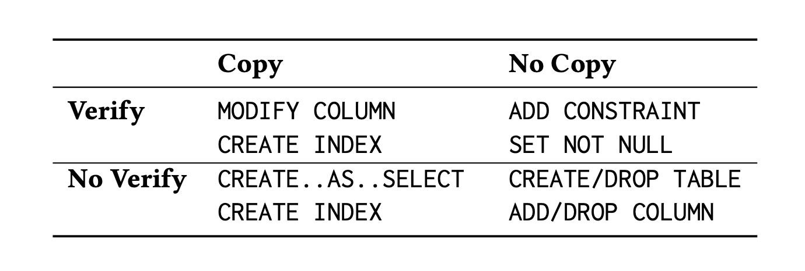

# Paper - Online Schema Evolution is (Almost) Free for Snapshot Databases (VLDB, 2023)

Hu, Wang (Simon Fraser University), Zhou (Tencent) · [PDF](https://www.vldb.org/pvldb/vol16/p140-hu.pdf) · the system is called Tesseract

## Section 1 - Introduction
* Tesseract's idea: a schema change is really two ordinary updates. Converting `status` is "update every row" plus "update the catalog row that says what type `status` is". If the database treats both as normal updates, the schema change gets versions and snapshots like any other write. A query that started before it keeps seeing the old schema and old rows, nobody waits on a special lock, and a failed conversion just rolls back. They call it "data-definition-as-modification".
* Claimed cost: even a heavy change like adding a column drops ordinary query throughput by "only up to ~10%".

## Section 2 - MVCC Background
* Tesseract is designed for databases that keep several versions of every row, known as multi-version concurrency control (MVCC). Each transaction sees a consistent snapshot, made of the versions that were committed before it started. PostgreSQL works this way too.
* Tesseract is built on ERMIA, a research engine that keeps everything in memory. Each table has an array indexed by row ID, and each entry points to that row's chain of versions.

> Question - In ERMIA, old row versions are chains in memory. In Postgres they're dead rows in the table file, cleaned up later by vacuum. Rewriting every row means a second copy of the table on disk until vacuum catches up, which is E3's 88 → 184 MB again.

> Question - What happens to indexes? In ERMIA they point to row IDs, so swapping the array keeps them valid. In Postgres a new copy of the table needs every index rebuilt to point at it.

> Question - Logs on a RAM disk aren't durable. What happens if the machine crashes halfway through a migration? And with real disks and real write-ahead logging, how much of the "~10%" survives?

## Section 3 - Tesseract Overview

### 3.1 Four kinds of schema change
* Every schema change answers two questions: does it have to copy or change the table's data, and does it have to read through the data to check it? (Table 1)

* A change that does neither only touches metadata, like adding or dropping a column.
* The same operation can land in a different box depending on how a database is built.

* To extrapolate into what I am doing: text → int is `MODIFY COLUMN`, in the copy-and-check box. Every row has to be rewritten, and every value checked to see if it converts. That's the most expensive kind, and it's what my E1 did.

> Question - "Check" for us means every status has to map to a number. What happens to a row with a value that doesn't, like `'refunded'`? Does the whole change fail, after all the copying is done?

### 3.2 Schema versioning
* A table's schema is stored as a row, a "schema record", in a catalog table. The catalog is an ordinary table.
* Schema records have versions, just like data rows. Each version carries a commit timestamp, and the paper calls them S1, S2 and so on.
* To read a table, a transaction first reads the schema version its snapshot can see, then reads the data that matches it.
* Data written under different schema versions is kept apart, in separate arrays (Figure 2).

* To extrapolate into what I am doing:
  * S1 says `orders.status` is text. S2 says it's an integer.
  * A query that started before S2 committed keeps seeing S1 and the text values, even while the change is running.
  * A query that starts after S2 commits sees integers.

> Question - "Data under different schema versions is kept apart" sounds like two copies of the table while both versions exist. Is that the 2× storage from E3 again? The paper only explains how the data gets there in Section 5.

> Question - This is the opposite of what I saw in E2, where a reader waited 2.7 s for the `ALTER` to finish. Here it would just read the old version. But it only helps queries that were already running. A query from the old app that starts after S2 commits gets integers, and nothing in Section 3 keeps the old app working.

> Question - Postgres also versions rows, but not every `ALTER TABLE` respects old snapshots. Local's sandbox saw an old snapshot go from 1,000 rows to 0 after a table rewrite. Worth checking on my Mac whether a reader that started before a rewrite really sees the old data in Postgres 16.

### 3.3 Schema changes and normal writes in one system
* One transaction can contain both schema changes and ordinary inserts and updates.
* A schema change is built out of ordinary writes: update the schema record, then do whatever inserts or updates are needed to change or check the data. It goes through the same concurrency control as any other transaction.
* An ordinary transaction reads the schema version its snapshot can see, and has to make sure the data and schema versions it uses match.
* Two ways they can clash:
  * A schema change has written a new schema record but not committed yet. An ordinary write that touches the same thing conflicts with it, and one of them aborts.
  * An ordinary transaction started under S1, and wants to commit after S2 has committed. If it did, later readers would read its old-shape row with the new schema. So this "must be forbidden". Their example: T2 began at timestamp 200, before S2 existed, so T2 must use S1 throughout.

> Question - "Forbidden" presumably means the old transaction is aborted. So any in-flight transaction from the old app that straddles the change fails, and the app has to retry it. That's F1's write fencing, on one machine. Is there a number for how many transactions get aborted this way?

> Question - In E9, one long transaction made everyone queue behind a waiting `ALTER`. Here, a long transaction that started before the change wouldn't block anyone, but it would be aborted if it tried to write after the change committed. Which is better depends on whether the long one or the many short ones matter more.

> Question - Postgres can also run DDL inside a transaction, and roll it back. MySQL can't. So the "DDL is just a transaction" part already exists in Postgres. What's missing there is the versioned schema that lets old snapshots keep reading.
